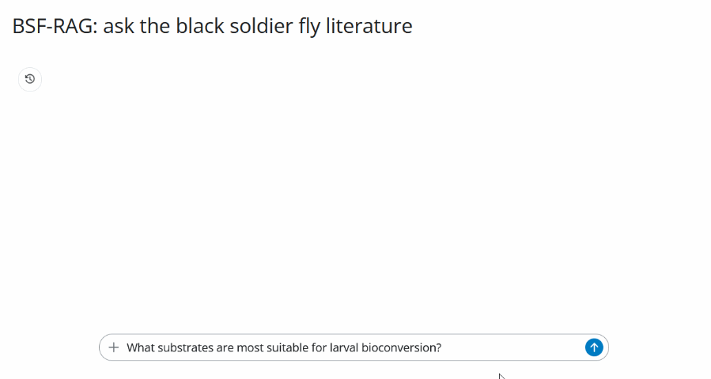

# bsfrag

<!-- badges: start -->
<!-- badges: end -->

**Ask the black soldier fly literature a question and get an answer that cites its sources.**

`bsfrag` is an R package for retrieval-augmented generation (RAG) over 1,106 open-access articles on the black soldier fly (*Hermetia illucens*). It retrieves the most relevant passages from the literature and has a large language model answer only from them, with numbered citations. If the sources do not cover a question, it says so.



## Why

Research on the black soldier fly has grown quickly and is spread across entomology, microbiology, waste engineering, animal nutrition and soil science. `bsfrag` makes that literature searchable by question rather than by keyword, while keeping every answer traceable to a paper.

## How it works

1. **Corpus:** CC BY / CC0 articles are found through the Europe PMC API and downloaded as JATS full-text XML (NCBI PMC as fallback).
2. **Conversion:** each article is converted to Markdown, keeping its section structure.
3. **Chunking and embedding:** heading-aware chunks are embedded locally with Ollama (`nomic-embed-text`) and stored in DuckDB via [ragnar](https://ragnar.tidyverse.org/).
4. **Retrieval:** questions are matched by combined vector and BM25 keyword search.
5. **Answering:** an LLM (Anthropic Claude via [ellmer](https://ellmer.tidyverse.org/)) answers only from the retrieved excerpts and cites them.
6. **Evaluation:** answers are scored against an expert question set (see below).

## Results

Evaluated on 19 expert questions (factual, quantitative, synthesis and out-of-scope), scored blind by hand. Details in [`eval/results.md`](eval/results.md).

| Setup | Retrieval hit rate | Mean correctness (0–2) | Share fully correct | Answers with hallucination | Correct refusals |
|:--|--:|--:|--:|--:|:--|
| LLM only, no retrieval | – | 0.60 | 0.00 | 2 | 3 / 4 |
| bsfrag, 4 chunks | 0.87 | 1.80 | 0.80 | 1 | 4 / 4 |
| bsfrag, 8 chunks | 0.87 | 1.80 | 0.80 | 0 | 4 / 4 |

Retrieval raised mean correctness from 0.60 to 1.80, with the largest gain on quantitative questions (0.00 → 1.80), where the model alone could not reproduce study-specific values.

## Quick start

Requirements: R ≥ 4.3, [Ollama](https://ollama.com) with `ollama pull nomic-embed-text`, and an `ANTHROPIC_API_KEY` in your `.Renviron`.

```r
# install.packages("pak")
pak::pak("tklammsteiner/bsfrag")
```

Clone the repository, then from the project folder:

```r
source("data-raw/download.R")   # 1. download the corpus (~30-60 min)
devtools::load_all()
build_store()                   # 2. build the store (resumable; can take hours)
```

Restart R, then:

```r
devtools::load_all()
store <- ragnar::ragnar_store_connect("bsf.duckdb", read_only = TRUE)
res <- ask_bsf("How does larval density affect substrate temperature?", store)
cat(res$answer)

run_app()                       # chat interface
```

The full texts and the store (~700 MB) are not included in the repository; they are rebuilt from `data-raw/corpus.csv`.

## Repository structure

| Path | Content |
|:--|:--|
| `R/` | Package functions: `build_store()`, `ask_bsf()`, `jats_to_markdown()`, `format_citation()`, `run_app()` |
| `inst/app/` | Shiny chat app |
| `inst/prompts/system.md` | System prompt |
| `data-raw/` | Corpus download script and article metadata (`corpus.csv`) |
| `eval/` | Question set, evaluation and summary scripts, scores and results |
| `tests/` | Unit tests (no API key needed) |

## Limitations

- Only open-access articles with a CC BY or CC0 licence on Europe PMC / PMC; English only.
- Tables, figures and supplementary material are not indexed.
- Answers can be incomplete or wrong and should be checked against the cited papers.
- The evaluation is small and was scored by one person (see `eval/results.md`).

## Licence and citation

Code: MIT. Article texts are not redistributed; the original licences apply. If you use `bsfrag`, please cite it using [`CITATION.cff`](CITATION.cff).
